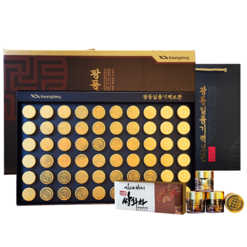
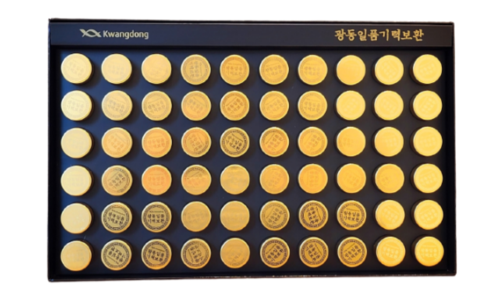
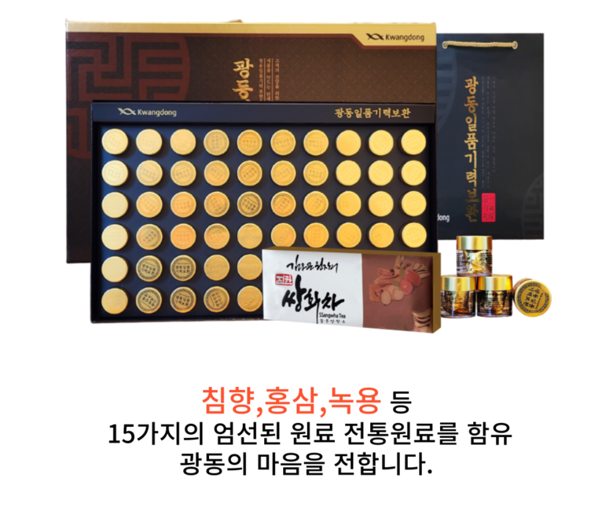
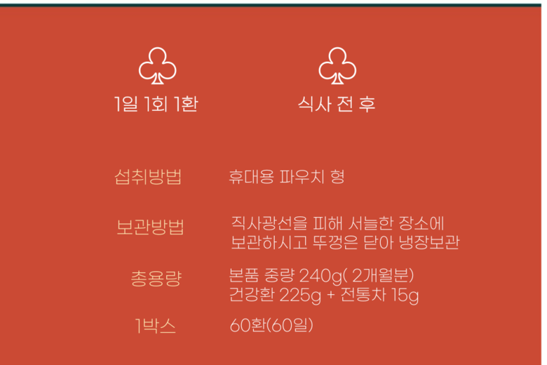
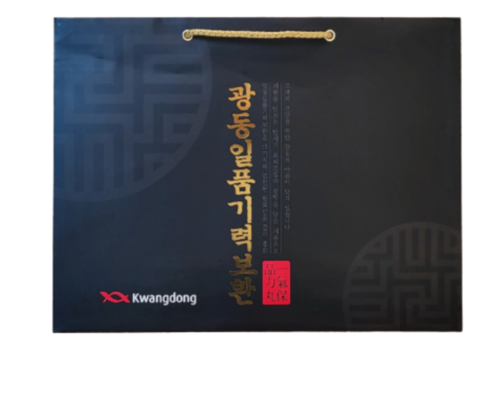

# 광동 침향 녹용 홍삼 기력보환 60환, 구성과 가격 정리(2026년 11월 기준)

환이 담긴 상자에 쌍화차와 쇼핑백이 함께 오는 구성이에요.

상품 이름이 길어서 헷갈리죠ㅎㅎ 쿠팡의 '광동 침향 녹용 홍삼 기력 보환 60환'은 광동생활건강이 판매하는 **광동일품기력보환**이에요. <mark>환 60개(2개월분)에 쌍화차 15g과 쇼핑백이 들어 있어요.</mark> 🎁

2026년 11월 3일 쿠팡 기준 가격은 54,000원, 무료배송이에요. 판매처 사정에 따라 가격은 바뀔 수 있어요. 원료부터 주문 전 확인할 점까지 차례로 정리했어요 :)

## 광동일품기력보환은 어떤 제품인가요?

환 모양의 일반 식품이에요. 건강기능식품이 아니라 '기타가공품'으로 분류돼요.

| 항목 | 내용 |
|---|---|
| 구성 | 환 60개(1개 3.75g) + 쌍화차 + 쇼핑백 |
| 총 중량 | 240g(환 225g + 쌍화차 15g) |
| 판매원 | 광동생활건강(유통전문판매원) |
| 제조원 | (주)한국네스트 |

트레이 한 칸에 환이 하나씩 담겨 있어요.

상세페이지 섭취방법 항목에는 <mark>'휴대용 파우치형'</mark>으로 나와요. 낱개 포장 방식까지는 자세히 설명돼 있지 않으니, 들고 다닐 생각이라면 받은 뒤 포장 상태를 확인해 보세요. 쌍화차의 원재료는 차 포장에서 확인해 보세요 🍵

## 15가지 원료와 함량 표시

<mark>침향, 녹용, 홍삼을 포함한 15가지 원료</mark>가 '식물혼합분말' 하나에 섞여 있어요. 원재료에는 이 밖에 벌꿀과 글리세린도 적혀 있고요.

대추, 감귤 껍질, 황기, 감초, 작약, 당귀, 지황, 백출, 계피, 오미자, 원지, 홍삼, 산수유, 침향, 녹용.

상세페이지에서도 "침향, 홍삼, 녹용 등 15가지" 원료로 소개하고 있어요.

상품명에 들어간 세 원료는 이런 재료예요.

- **침향:** 침향나무 줄기에 수지가 스며들어 굳은 목재. 인도네시아산이에요.
- **녹용:** 수사슴의 어린 뿔을 잘라 말린 것. 뉴질랜드산을 써요.
- **홍삼:** 인삼 뿌리를 쪄서 만든 재료. 국산으로 표시돼 있어요.

다만 원료별 함량은 표시돼 있지 않아요.

## 먹는 법과 보관법

상세페이지 안내는 <mark>하루 1번, 1환, 식사 전후</mark>예요. 정해진 시각은 따로 없어서, 식사 전후 중 매일 같은 때를 정해 두면 돼요.

보관은 직사광선을 피한 서늘한 곳이 기본이에요. 상세페이지는 뚜껑을 닫아 냉장 보관하라고도 안내해요. 어린이 손이 닿지 않는 곳에 두세요.

섭취량과 보관법, 240g 구성이 한 장에 정리돼 있어요.

## 먹기 전에 확인할 주의사항

판매처에 실린 제품 표시사항을 기준으로 골랐어요. 포장 문구는 바뀔 수 있으니 받은 상자의 뒷면도 함께 읽어 보세요.

- 몸에 열이 많은 편이면 한 알을 반으로 나눠 드세요.
- 임산부, 수유부, 질병 치료 중인 분은 전문가와 먼저 상의하세요.
- 온도 변화로 환이 굳을 수 있어요. 치아가 다치지 않게 조심하세요.
- 목에 걸리지 않게 잘 씹어 드세요.
- 알레르기 체질이면 원재료를 먼저 확인하세요.
- 기한이 지난 제품은 먹지 마세요.

같은 제조시설에서 우유, 땅콩, 대두, 밀 등을 쓴 제품도 만든다고 안내돼 있어요. 원재료에 들었다는 뜻은 아니지만, 알레르기가 심하다면 참고하세요.

## 주문 전에 무엇을 확인할까요?

선물로 고른다면 두 가지를 봐 주세요.

1. **옵션 이름:** 쇼핑백이 포함된 옵션은 <mark>'60환 240g (2개월)+쇼핑백'</mark>이에요. 같은 페이지의 30환 등 다른 옵션은 구성이 다를 수 있어요.
2. **받는 분:** 임신·수유 중이거나 알레르기가 있는 분께 드린다면 위 주의사항도 함께 전해 주세요.

이 옵션에 함께 오는 쇼핑백이에요. 받은 뒤 구성품이 빠짐없이 들어 있는지 한 번 살펴보세요 😊
