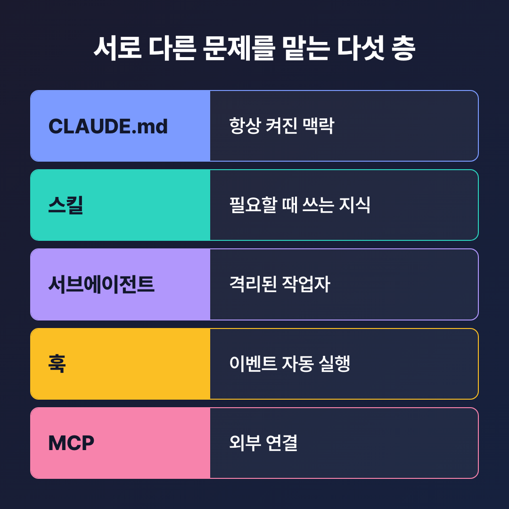
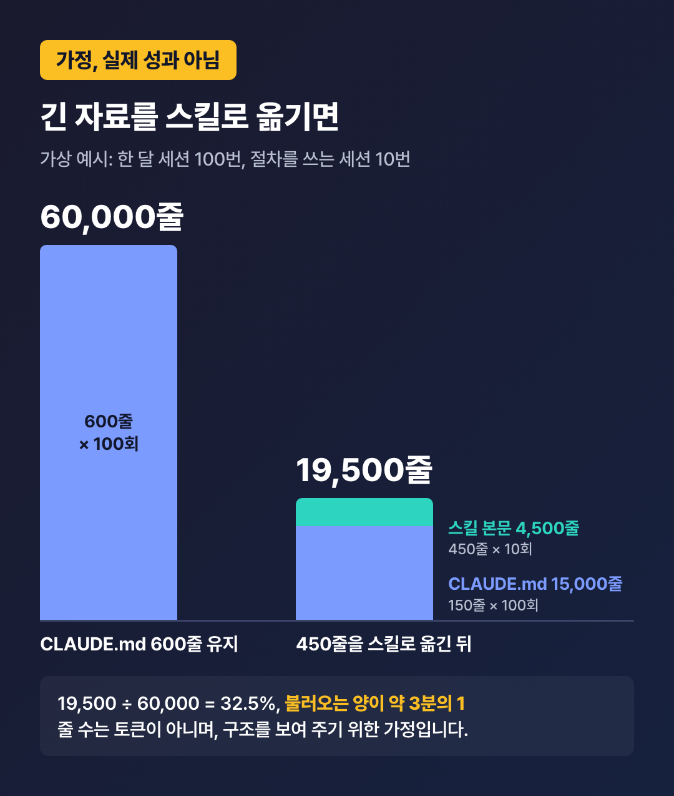
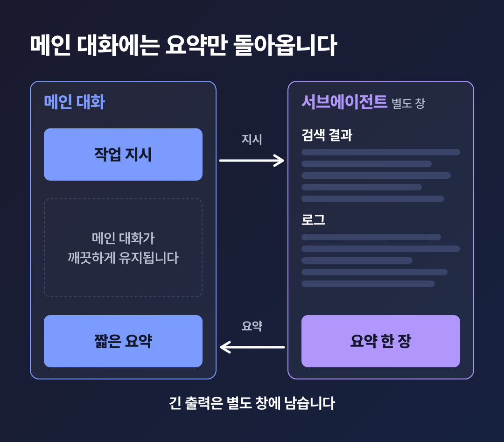
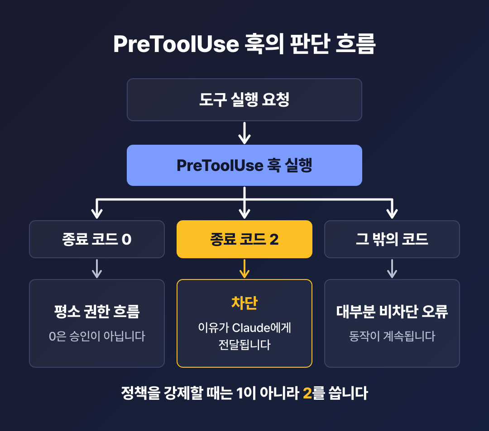
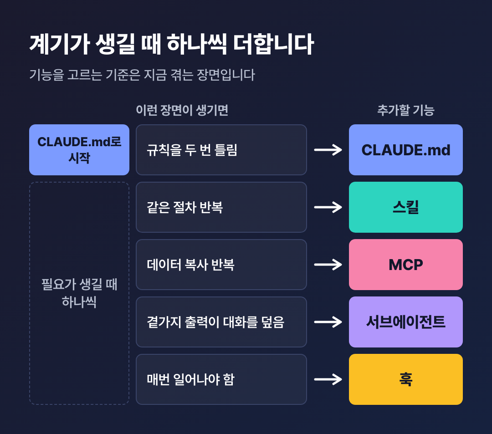

# 클로드 코드 핵심 기능 5가지란? 2026년 11월 기준 도입 순서

메타 설명: 클로드 코드의 CLAUDE.md, 스킬, 서브에이전트, 훅, MCP가 각각 어떤 문제를 푸는지 정리했습니다. 쓰는 시점과 도입 순서까지 담았습니다.
태그: #클로드코드 #ClaudeCode #CLAUDE.md #클로드코드스킬 #서브에이전트 #클로드코드훅 #MCP #에이전트형코딩도구

클로드 코드로 사내 도구를 손보기 시작한 지 몇 주가 지났습니다.  
어제 고쳐 달라고 한 규칙을 오늘 또 틀립니다.  
설정 글을 찾아보니 스킬, 훅, MCP까지 낯선 이름이 줄지어 나옵니다.  
**이걸 전부 설정해야 제대로 쓰는 걸까요?**

이럴 때 결론은 보통 둘 중 하나로 갑니다.  
“일단 다 설치해 보죠.”  
“어려우니까 그냥 프롬프트로 버티죠.”

**1. 같은 지시를 세션마다 다시 입력한다**  
**2. CLAUDE.md에 적었으니 Claude가 꼭 지킨다고 생각한다**  
**3. 스킬, 서브에이전트, 훅의 차이를 설명하기 어렵다**

하나라도 해당된다면, 두 결론 모두 아직은 이릅니다.  
다섯 기능은 많이 켤수록 좋은 옵션이 아니라  
서로 다른 문제를 푸는 도구이기 때문입니다.

항상 필요한 규칙은 CLAUDE.md, 가끔 필요한 절차는 스킬이 맡습니다.  
격리할 작업은 서브에이전트, 매번 일어나야 할 동작은 훅,  
외부 서비스 연결은 MCP의 몫입니다.  
시작은 CLAUDE.md 하나면 되고,  
나머지는 필요가 생길 때 하나씩 더합니다.

이 글은 2026년 11월 3일에 확인한 공식 문서를 기준으로 합니다.  
당시 최신 버전은 10월 31일에 나온 2.1.316입니다.  
버전별 세부 수치는 업데이트로 바뀔 수 있습니다.  
오늘은 다섯 기능의 역할부터 정리해 보겠습니다.

## 클로드 코드 핵심 기능이란? 서로 다른 문제를 맡는 다섯 층입니다

클로드 코드(Claude Code)는 코드베이스를 읽고  
파일을 고치고 명령을 실행하는 에이전트형 코딩 도구입니다.  
터미널, IDE, 데스크톱 앱, 브라우저에서 쓸 수 있습니다.

먼저 밝혀 둘 점이 있습니다.  
공식 문서에 ‘핵심 기능 5가지’라는 분류는 없습니다.  
이 글의 다섯 가지는 공식 문서가 확장 기능을 설명하며  
나란히 드는 항목을 기준으로 저희가 고른 것입니다.  
파일 편집, 명령 실행 같은 기본 도구는 맥락 설명에만 씁니다.

공식 문서의 구분을 한 문장으로 옮기면 이렇습니다.

**CLAUDE.md는 항상 켜진 맥락을, 스킬은 필요할 때 쓰는 지식을,**  
**MCP는 외부 연결을, 서브에이전트는 격리를, 훅은 자동화를 맡습니다.**

회사 하나로 생각하면 쉽습니다.  
CLAUDE.md는 매일 아침 읽는 사내 규정집이고,  
스킬은 필요할 때 꺼내 보는 업무 매뉴얼입니다.  
서브에이전트는 별도 회의실에서 일하고 요약만 내놓는 담당자이고,  
훅은 문이 열리면 저절로 울리는 경보기입니다.

MCP는 외부 거래처로 이어지는 전화선에 가깝습니다.  
다만 이건 이해를 돕는 비유이지,  
실제 구조가 회사와 똑같다는 뜻은 아닙니다.

기능을 가르는 기준은 세 가지입니다.  
언제 컨텍스트에 올라오는지, 비용이 얼마인지,  
모델의 판단에 맡기는지 시스템이 강제하는지입니다.  
컨텍스트는 Claude가 작업 중에 붙들고 있는 대화와 자료의 공간입니다.

| 기능 | 맡는 일 | 언제 올라오나 | 컨텍스트 비용 | 강제력 |
| --- | --- | --- | --- | --- |
| CLAUDE.md | 세션마다 읽는 지속 지침 | 세션 시작 시 전체 | 매 요청 발생 | 권고, 모델이 판단 |
| 스킬 | 재사용하는 지식과 절차 | 시작 시 설명만, 사용 시 본문 | 낮음, 설명은 매 요청 | 권고, 사용자만 호출하게 제한 가능 |
| 서브에이전트 | 격리된 작업자, 요약만 반환 | 생성될 때 | 메인과 분리 | 위임 범위와 도구를 설정으로 제한 |
| 훅 | 수명주기 이벤트에 자동 실행 | 이벤트 발생 시 | 0, 출력을 돌려줄 때만 발생 | 결정적으로 실행 |
| MCP | 외부 서비스와 도구 연결 | 시작 시 도구 이름, 필요 시 스키마 | 사용 전까지 낮음 | 외부 도구 호출에 권한 규칙 적용 |

표의 로드 시점과 비용은 공식 문서의 표를,  
강제력은 공식 모범 사례의 구분을 따랐습니다.  
서브에이전트와 MCP의 강제력 칸은 공식 분류에 없습니다.  
문서 내용을 바탕으로 적은 해석으로 읽어 주세요.

저희는 이 다섯을 대체재가 아니라 역할이 다른 층으로 봅니다.  
공식 문서, 공식 블로그, 독립 저자의 글도 같은 구도로 설명합니다.



다섯 기능은 경쟁 관계가 아니라 서로 다른 문제를 맡는 층입니다.

## 1. CLAUDE.md와 자동 메모리, 무엇이 다를까요?

**CLAUDE.md는 사람이 쓰는 지침이고,**  
**자동 메모리는 Claude가 스스로 쓰는 메모입니다.**

모든 세션은 빈 컨텍스트로 시작합니다.  
이 둘이 지식을 다음 세션으로 넘기는 장치입니다.

| 항목 | CLAUDE.md | 자동 메모리 |
| --- | --- | --- |
| 작성자 | 사용자 | Claude |
| 내용 | 지침과 규칙 | 학습 내용과 패턴 |
| 범위 | 프로젝트, 사용자, 조직 | 저장소 단위, 워크트리끼리 공유 |
| 로드 | 매 세션 | 매 세션, 앞 200줄 또는 25KB |

CLAUDE.md는 범위에 따라 놓는 곳이 다릅니다.

- **개인 전역:** `~/.claude/CLAUDE.md`
- **팀 공유:** `./CLAUDE.md` 또는 `./.claude/CLAUDE.md`
- **개인 프로젝트용:** `./CLAUDE.local.md`, `.gitignore`에 추가합니다.

여기에 조직 관리 정책 파일이 더해질 수 있습니다.  
여러 파일은 서로 덮어쓰지 않고 이어 붙습니다.

공식 문서가 권하는 작성법은 네 가지로 추릴 수 있습니다.

1. **200줄 이하를 목표로 합니다:** 길수록 컨텍스트를 더 쓰고 지시 준수율도 떨어집니다.
2. **검증할 수 있게 씁니다:** “코드를 잘 정리하세요” 대신 “2칸 들여쓰기를 쓰세요”처럼 적습니다.
3. **코드에서 찾을 수 있는 내용은 뺍니다:** 검증 명령, 오해하기 쉬운 코드, 저장소 밖에서 내린 결정, 두 번 이상 고쳐 준 내용을 남깁니다.
4. **`/init`으로 초안을 만듭니다:** 이미 파일이 있으면 덮어쓰지 않고 개선안을 제안합니다.

또 하나, `@경로` 가져오기는 파일을 나눌 뿐 컨텍스트를 줄이지 않습니다.  
가져온 파일도 함께 로드되기 때문입니다.  
줄이려면 `paths`로 범위를 정한 `.claude/rules/` 규칙이나 스킬로 옮깁니다.

자동 메모리는 기본으로 켜져 있고 `/memory`로 켜고 끕니다.  
저장 위치는 `~/.claude/projects/<project>/memory/`입니다.  
기기 안에만 있고 다른 기기나 클라우드로 공유되지 않습니다.  
코드에서 알아낼 수 있는 내용이나  
CLAUDE.md에 이미 있는 내용은 저장하지 않습니다.

> “CLAUDE.md에 굵게 적어 두면 Claude가 꼭 지키는 거 아닌가요?”

그렇게 단정할 근거는 없습니다.  
**CLAUDE.md는 강제 설정이 아니라 맥락입니다.**  
공식 모범 사례는 강조를 덧붙여도 Claude가 놓친다면  
그 줄을 훅으로 옮길 대상으로 봅니다.

그래서 저희는 한 줄을 적기 전에  
“이건 부탁인가, 막아야 할 일인가”부터 따져 보시길 권합니다.

[경험 보충: 실제 운영 중인 CLAUDE.md에서 뺀 줄과 남긴 줄 사례, 길이를 줄인 전후에 달라진 점]

## 2. 스킬은 언제 쓸까요? 같은 절차를 세 번째 붙여 넣을 때입니다

공식 문서가 드는 도입 계기는 같은 절차를 세 번째 붙여 넣을 때입니다.  
스킬은 지식, 워크플로, 지침을 담은 마크다운 파일입니다.  
형식은 폴더 안의 `SKILL.md` 파일입니다.

스킬은 두 종류로 나뉩니다.  
**참조형은 세션 내내 쓰는 지식이고, 실행형은 특정 작업을 시키는 절차입니다.**  
API 스타일 가이드가 참조형이고, `/deploy`가 실행형입니다.

컨텍스트에 유리한 이유는 불러오는 순서에 있습니다.  
시작할 때는 이름과 설명만 올리고, 본문은 쓸 때 올립니다.  
Agent Skills 표준은 이 방식을  
점진적 공개(progressive disclosure)라고 부릅니다.  
그래서 긴 참고 자료는 CLAUDE.md보다 스킬에 두는 편이 낫습니다.

공식 문서 형식을 기준으로 한 예시입니다.

```yaml
---
name: deploy
description: 애플리케이션을 프로덕션에 배포합니다
disable-model-invocation: true
---

$ARGUMENTS 를 프로덕션에 배포하세요:
1. 테스트 스위트 실행
2. 애플리케이션 빌드
3. 배포 대상에 푸시
4. 배포 성공 여부 확인
```

개인용은 `~/.claude/skills/<이름>/SKILL.md`에 둡니다.  
프로젝트용은 `.claude/skills/<이름>/SKILL.md`에 두고,  
커밋하면 팀이 함께 씁니다.

호출 방식은 머리말 설정으로 조절합니다. 자주 보는 것은 세 가지입니다.

- **`disable-model-invocation: true`:** Claude가 자동으로 호출하지 못합니다. 배포처럼 부작용이 있는 작업에 씁니다.
- **`user-invocable: false`:** `/` 메뉴에서 숨기고 Claude만 씁니다. 배경 지식용입니다.
- **`context: fork`:** 서브에이전트에서 격리해 실행합니다.

첫 번째 설정을 쓰면 설명도 컨텍스트에 올라가지 않습니다.  
호출 전 비용이 0인 셈입니다.  
그래서 저희는 되돌리기 어려운 작업이라면  
이 설정부터 확인해 보시길 권합니다.

이미 `.claude/commands/`를 쓰고 계셔도 걱정하실 일은 아닙니다.  
커스텀 명령은 스킬로 통합됐고 기존 파일은 계속 작동합니다.  
다만 새로 만든다면 스킬 형식을 권합니다.

`/code-review`, `/batch`, `/debug`는 설정 없이 쓰는 기본 제공 스킬입니다.  
2026년 8월 31일~9월 4일 주간에 나온 `/skill-doctor`는  
스킬별 컨텍스트 비용과 사용 빈도를 보여 줍니다.

그렇다고 스킬이 늘 같은 결과를 내는 것은 아닙니다.  
절차를 지시문으로 전달하는 방식이라 결과는 달라질 수 있습니다.  
설명이 모호하거나 겹치면 엉뚱한 스킬을 불러오기도 합니다.  
확실히 쓰게 하려면 `/이름`으로 직접 호출합니다.

## 숫자로 한 번 보겠습니다: 긴 자료를 스킬로 옮기면 무엇이 달라질까요?

**가정**

이 글의 숫자는 모두 설명을 위한 가상 예시이며 실제 성과가 아닙니다.  
드립백 커피 몰을 운영하는 A씨의 CLAUDE.md가 600줄이라고 해 보죠.  
그중 450줄은 반품 처리와 정산 절차처럼 가끔만 보는 내용입니다.  
한 달에 세션을 100번 열고, 이 절차는 그중 10번만 쓴다고 가정합니다.

계산을 보겠습니다.  
그대로 두면 600줄 × 100회 = 60,000줄을 불러옵니다.  
450줄을 스킬로 옮기면 CLAUDE.md는 150줄 × 100회 = 15,000줄입니다.  
스킬 본문은 450줄 × 10회 = 4,500줄입니다.  
합치면 15,000 + 4,500 = 19,500줄입니다.

**19,500 ÷ 60,000 = 32.5%, 불러오는 양이 약 3분의 1로 줄어드는 셈입니다.**

그런데 이 숫자를 실제 절감률이라고 부르면 안 됩니다.  
줄 수는 토큰이 아니고, 스킬 설명의 비용도 뺐습니다.  
CLAUDE.md는 세션이 아니라 매 요청 비용이 생기는 점도 단순화했습니다.  
스킬의 효과를 측정한 공식 수치도 찾지 못했습니다.  
이 숫자는 구조를 보여 주기 위한 가정입니다.

실제 토큰 사용량은 `/context all`로 확인합니다.



자주 쓰지 않는 내용일수록 스킬로 옮겼을 때 매번 싣는 양이 줄어듭니다.

## 3. 서브에이전트는 왜 필요할까요? 메인 대화를 지키기 위해서입니다

**서브에이전트는 자기만의 컨텍스트 창, 시스템 프롬프트,**  
**도구 권한을 가진 전문 작업자입니다.**  
검색 결과나 로그처럼 양이 많은 출력을 대신 처리하고  
요약만 돌려주므로 메인 대화가 깨끗하게 유지됩니다.

스킬과 헷갈리기 쉽습니다.  
**스킬은 불러오는 내용이고, 서브에이전트는 일을 맡기는 작업자입니다.**  
스킬은 메인 창에 더해지고, 서브에이전트는 별도 창을 씁니다.  
둘을 함께 쓸 수도 있습니다.  
서브에이전트가 `skills:` 필드로 스킬을 미리 불러오는 식입니다.

대표적인 내장 서브에이전트는 세 가지입니다.  
Explore는 읽기 전용 탐색을, Plan은 계획용 조사를 맡고,  
general-purpose는 범용으로 씁니다.

직접 만들 때는 Claude에게 요청해도 되고,  
`.claude/agents/`(프로젝트)나 `~/.claude/agents/`(개인)에  
마크다운 파일을 써도 됩니다.  
꼭 적어야 하는 항목은 `name`과 `description`입니다.  
아래는 공식 문서의 예시를 한국어로 옮긴 것입니다.

```markdown
---
name: code-reviewer
description: 코드 품질과 모범 사례를 검토. 코드 변경 후 사용.
tools: Read, Glob, Grep
model: sonnet
---

코드를 분석한 뒤 품질, 보안, 모범 사례에 대해
구체적이고 실행 가능한 피드백을 제공하세요.
```

`tools`는 쓸 도구를 제한하고, `model`은 쓸 모델을 지정합니다.  
`isolation: worktree`를 쓰면 임시 git 워크트리에서 격리해 실행합니다.

서브에이전트는 메인 대화 기록 없이 새로 시작합니다.  
자체 시스템 프롬프트, 지정한 스킬 전문, CLAUDE.md와 git 상태,  
메인 에이전트가 프롬프트로 넘긴 내용을 받습니다.  
다만 Explore와 Plan은 기본적으로 CLAUDE.md와 git 상태를 로드하지 않습니다.  
대화 전체가 필요하면 포크(fork)로 시작합니다.



긴 출력은 별도 창에 남고 메인 대화에는 요약만 돌아옵니다.

현재 한도는 숫자로 봐 두시면 됩니다.  
**메인 대화 아래 기본 3계층까지 중첩할 수 있고,**  
**동시 실행은 세션당 기본 20개입니다.**  
중첩 깊이는 `CLAUDE_CODE_MAX_SUBAGENT_SPAWN_DEPTH`로 바꿀 수 있습니다.

2026년 6월의 공식 소식과 블로그에는 최대 5단계로 적혀 있습니다.  
현재 서브에이전트 문서와 환경 변수 문서는 기본 3계층으로 적습니다.  
환경 변수 문서의 변경 이력을 근거로 3계층을 현재 값으로 봅니다.

물론 많이 띄운다고 공짜는 아닙니다.  
여러 세션이나 서브에이전트를 동시에 돌리면 토큰 사용량도 그만큼 늘어납니다.  
같은 파일을 건드리는 작업은 워크트리로 분리합니다.  
그래서 저희는 곁가지 출력이 대화를 덮을 때부터 쓰시길 권합니다.

독립 저자 Daniil Okhlopkov는 에이전트 세 개를 병렬로 돌려  
반나절 걸리던 지갑 분석을 약 15분으로 줄였다고 적었습니다.  
다만 측정 조건이 공개되지 않은 개인 경험담입니다.  
같은 효과를 기대할 근거로 삼을 수는 없습니다.

## 4. 훅은 스킬과 무엇이 다를까요? 실행 여부를 Claude가 고르지 않습니다

**훅은 수명주기의 특정 시점, 즉 이벤트에 반응해**  
**자동으로 실행되는 동작입니다.**  
공식 문서는 이를 ‘결정적 제어’라고 설명합니다.  
LLM이 실행 여부를 고르게 두지 않고  
특정 동작이 매번 일어나게 한다는 뜻입니다.

공식 모범 사례는 지시를 두 종류로 나눕니다.

- **비결정적:** 프롬프트, CLAUDE.md, 스킬. 모델이 읽고 판단합니다. 대개 따르지만 보장은 없습니다.
- **결정적:** 훅, 거부 규칙, 관리형 설정. 모델의 판단과 관계없이 Claude Code가 매번 적용합니다.

공식 문서의 예시가 분명합니다.  
CLAUDE.md의 “`.env`를 고치지 마세요”는 부탁이지 보장이 아닙니다.  
이를 막는 `PreToolUse` 훅이 강제 수단입니다.  
공식 블로그는 “A real guardrail needs to be deterministic”라고 적습니다.  
진짜 안전장치는 결정적이어야 한다는 뜻입니다.

자주 쓰는 이벤트는 여섯 가지입니다.

| 이벤트 | 시점 | 대표 용도 |
| --- | --- | --- |
| `PreToolUse` | 도구 실행 전, 차단 가능 | 보호 파일 수정 막기, 위험 명령 차단 |
| `PostToolUse` | 도구 성공 후 | 포매터, 린터 실행 |
| `Notification` | 알림을 보낼 때 | 입력 대기 알림 |
| `Stop` | 응답을 마칠 때 | 타입 검사 통과 강제 |
| `SessionStart` | 세션 시작 또는 재개 시 | 컴팩션 뒤 맥락 다시 주입 |
| `PreCompact` | 컴팩션 전 | 대화 기록 백업 |

전체 이벤트는 공식 가이드 표의 행을 세면 33개입니다.  
문서에 적힌 값이 아니라 2026년 11월 3일 기준으로 표를 센 숫자입니다.

훅 종류는 다섯 가지입니다.  
`command`는 셸 명령, `http`는 URL로 POST,  
`mcp_tool`은 MCP 도구 호출을 맡습니다.  
`prompt`는 한 번의 LLM 평가이고,  
`agent`는 도구를 쓰는 다중 턴 검증으로 실험적 기능입니다.

공식 블로그는 앞의 셋은 결정적으로 실행되고,  
뒤의 둘은 모델의 판단을 쓴다고 구분합니다.  
저희는 이렇게 읽습니다.  
실행 여부는 결정적이고, `prompt`와 `agent`의 판정 결과는 모델에 달려 있습니다.

초심자가 가장 많이 헷갈리는 곳은 종료 코드입니다.

| 종료 코드 | 의미 | 기억할 점 |
| --- | --- | --- |
| 0 | 이의 없음 | `PreToolUse`에서 0은 승인이 아니며 평소 권한 흐름을 거칩니다 |
| 2 | 차단 | stderr의 이유가 Claude에게 전달됩니다. 차단할 수 없는 이벤트에서는 그대로 진행됩니다 |
| 그 밖의 코드 | 대부분 비차단 오류 | 동작이 계속됩니다. 코드 1로는 막지 못합니다 |

**정책을 강제할 때는 1이 아니라 2를 씁니다.**



`PreToolUse`에서 차단으로 처리되는 종료 코드는 2입니다.

설정은 `settings.json`의 `hooks` 키에 넣습니다.  
아래는 파일을 고친 뒤 포매터를 실행하는 공식 가이드의 예시 형식입니다.

```json
{
  "hooks": {
    "PostToolUse": [
      {
        "matcher": "Edit|Write",
        "hooks": [{ "type": "command", "command": "jq -r '.tool_input.file_path' | xargs npx prettier --write" }]
      }
    ]
  }
}
```

등록한 훅은 `/hooks`로 확인합니다.  
공식 문서는 범위를 좁히라는 경고도 함께 둡니다.  
`PermissionRequest` 훅의 `matcher`를 `.*`로 쓰거나 비워 두면  
파일 쓰기와 셸 명령까지 모든 권한 요청이 자동 승인됩니다.

그렇다고 모든 규칙을 훅으로 옮길 일은 아닙니다.  
공식 문서는 대부분의 경우 Claude가 판단하게 두는 편이 낫고,  
단순한 선호에 불과한 훅은 지우라고 권합니다.  
그래서 저희는 어겼을 때 되돌리기 어려운 규칙부터 훅으로 옮기시길 권합니다.

[경험 보충: 실제로 등록해 둔 훅 하나와 그 훅이 막아 준 상황, 훅을 쓰지 않았을 때와 달라진 점]

## 5. MCP는 무엇을 연결할까요? 외부 서비스와 데이터입니다

**Model Context Protocol, 줄여서 MCP는**  
**AI 애플리케이션을 외부 시스템에 연결하는 오픈소스 표준입니다.**  
공식 사이트는 이를 “AI 애플리케이션의 USB-C 포트”에 비유합니다.  
Claude뿐 아니라 ChatGPT, Visual Studio Code, Cursor 등도 지원합니다.

연결하면 이런 일을 맡길 수 있습니다.  
이슈 트래커의 티켓을 읽어 구현하고 GitHub에 PR을 올립니다.  
데이터베이스를 자연어로 조회하고, Slack에 글을 올립니다.  
다른 시스템의 데이터를 채팅에 계속 복사하고 있다면 도입할 신호입니다.

연결 방식은 세 가지입니다.  
HTTP 원격 서버가 권장 방식이고, SSE는 지원 중단 예정이며,  
로컬 프로세스는 stdio로 실행합니다.

```bash
# 원격 HTTP 서버 추가
claude mcp add --transport http notion https://mcp.notion.com/mcp

# 로컬 stdio 서버 추가
claude mcp add --env AIRTABLE_API_KEY=YOUR_KEY --transport stdio airtable \
  -- npx -y airtable-mcp-server
```

추가한 뒤에는 세션 안에서 `/mcp`로 상태 확인, 인증, 재연결을 합니다.  
적용 범위는 세 가지입니다.

| 범위 | 쓰는 사람과 위치 |
| --- | --- |
| `local` | 기본값. 현재 프로젝트에서 나만 씁니다 |
| `project` | `.mcp.json`으로 팀과 공유합니다 |
| `user` | 내 모든 프로젝트에 적용합니다 |

이름이 겹치면 local, project, user 순서로 적용됩니다.

여기서 많이들 걱정하시는 것이 컨텍스트 비용입니다.  
예전에는 MCP를 많이 붙일수록 도구 정의가 컨텍스트를 차지했습니다.  
현재는 도구 검색(tool search)이 기본으로 켜져 있습니다.  
시작할 때 도구 이름과 서버 지침만 올리고,  
전체 스키마는 필요할 때 불러옵니다.

다만 공짜라는 뜻은 아닙니다.  
공식 문서는 실질적 한계가 컨텍스트 창이라고 설명합니다.  
일부 구형 모델과 Azure에서 호스팅되는 Microsoft Foundry 배포에서는  
처음부터 전부 로드합니다.  
도구 출력도 1만 토큰을 넘으면 경고가 뜨고, 기본 상한은 2만 5천 토큰입니다.

**MCP는 연결을, 스킬은 그 연결을 잘 쓰는 법을 제공합니다.**  
MCP로 데이터베이스에 연결하고,  
스킬에 스키마와 쿼리 패턴을 적어 두는 식입니다.

보안도 함께 봐야 합니다.  
외부 콘텐츠를 가져오는 서버에는 프롬프트 인젝션 위험이 있습니다.  
공식 문서는 연결 전에 서버를 신뢰할 수 있는지 확인하라고 경고합니다.  
그래서 저희는 서버를 붙이기 전에 만든 곳부터 확인해 보시길 권합니다.  
데이터베이스는 읽기 전용 계정으로 연결하는 편이 낫습니다.

Okhlopkov도 서버는 한 번에 많이 붙이지 말고 하나씩 늘리라고 조언합니다.  
개인의 조언이지만, 공식 문서가 권하는 순서와 같은 방향입니다.

## 다섯 기능, 어떤 순서로 도입할까요? 계기가 생길 때 하나씩입니다

**공식 문서가 권하는 순서는 CLAUDE.md로 시작해**  
**필요가 생길 때마다 하나씩 더하는 것입니다.**  
한꺼번에 설정하지 말라는 뜻입니다.

공식 문서가 드는 계기는 이렇습니다.

| 이런 장면이 생기면 | 추가할 기능 |
| --- | --- |
| Claude가 규칙이나 명령을 두 번 틀렸다 | CLAUDE.md |
| 같은 프롬프트나 절차를 계속 입력한다 | 스킬 |
| Claude가 못 보는 브라우저 탭의 데이터를 계속 복사한다 | MCP |
| 곁가지 작업의 출력이 대화를 덮는다 | 서브에이전트 |
| 묻지 않아도 매번 일어나게 하고 싶다 | 훅 |



기능을 고르는 기준은 유행이 아니라 지금 겪는 장면입니다.

기능끼리는 함께 쓸 수 있습니다.  
공식 문서의 조합 예시는 네 가지입니다.

- **스킬 + MCP:** MCP가 연결하고 스킬이 사용법을 알려 줍니다.
- **스킬 + 서브에이전트:** `/audit` 스킬이 보안, 성능, 스타일 서브에이전트를 시작합니다.
- **CLAUDE.md + 스킬:** CLAUDE.md는 “API 규약을 따르라”고 적고, 전체 가이드는 스킬에 둡니다.
- **훅 + MCP:** 중요한 파일이 바뀌면 훅이 MCP로 Slack 알림을 보냅니다.

여러 곳에 같은 정의가 있을 때도 기억해 두시면 좋습니다.  
CLAUDE.md는 모두 합쳐지고, 훅도 모두 실행됩니다.  
스킬, 서브에이전트, MCP 서버는 이름 기준으로 하나만 적용됩니다.  
스킬은 개인이, 서브에이전트는 프로젝트가 우선이라 순서가 반대입니다.

아직 설치 전이라면 시작은 간단합니다.  
macOS, Linux, WSL에서는 아래 명령으로 설치합니다.  
대부분의 환경에 Claude 구독이나 Anthropic Console 계정이 필요합니다.

```bash
curl -fsSL https://claude.ai/install.sh | bash
```

Windows PowerShell에서는 `irm https://claude.ai/install.ps1 | iex`를 씁니다.  
설치 후 프로젝트 폴더에서 `claude`를 실행하시면 됩니다.

[경험 보충: 실제로 다섯 기능을 도입한 순서와 기간, 단계별로 달라진 점, 사용 환경. 직접 찍은 터미널 화면이 있으면 함께 첨부]

## 자주 받는 질문

### Q. 다섯 가지를 전부 설정해야 하나요?

그렇지 않습니다.  
공식 모범 사례는 대부분의 경우  
첫 프롬프트부터 기본값이 잘 작동하도록 만들어졌다고 설명합니다.  
설정은 프로젝트 고유의 지식과 규칙을 Claude가 알 수 없을 때 필요합니다.  
**막히는 지점이 생긴 기능 하나만 더하시면 됩니다.**

### Q. CLAUDE.md와 스킬 중 어디에 적어야 하나요?

얼마나 자주 필요한지에 따라 다릅니다.  
항상 알아야 하면 CLAUDE.md, 가끔 필요하면 스킬입니다.  
CLAUDE.md에는 한 줄 원칙만 적고  
전체 가이드는 스킬에 두는 조합도 공식 문서의 예시입니다.

### Q. 스킬이 있으면 MCP는 없어도 되나요?

목적에 따라 다릅니다.  
**MCP는 도구와 데이터 접근을, 스킬은 지식과 절차를 제공합니다.**  
공식 문서의 예시처럼 MCP로 데이터베이스에 연결하고  
스킬에 쿼리 패턴을 적어 두면 둘은 함께 쓰는 짝이 됩니다.

### Q. 플러그인은 여섯 번째 기능 아닌가요?

그보다는 포장 계층에 가깝습니다.  
스킬, 에이전트, 훅, MCP 서버를 한 단위로 묶어 설치하고 배포합니다.  
여러 프로젝트나 팀에 나눠 줄 때 쓰면 됩니다.  
다만 사용자 권한으로 실행되므로 설치 전에 검토해야 합니다.  
활성화해 두면 쓰지 않는 세션에도 이름과 설명이 컨텍스트를 차지합니다.

* * *

CLAUDE.md는 항상 알아야 할 것을, 스킬은 가끔 필요한 것을 담습니다.  
서브에이전트는 일을 나누고, 훅은 매번 실행하고, MCP는 바깥과 잇습니다.  
역할만 섞지 않아도 어디부터 손댈지 훨씬 차분해집니다.

대표님들, 이번 주에는 딱 한 가지만 해 보세요.  
Claude에게 두 번 고쳐 준 규칙 하나를 고릅니다.  
“2칸 들여쓰기를 쓰세요”처럼 확인할 수 있는 문장으로  
CLAUDE.md에 한 줄만 적어 두시면 됩니다.  
**기능을 다 켜는 것보다 한 줄을 제대로 적는 것,**  
**그게 클로드 코드를 내 일에 맞추는 첫걸음입니다.**

참고: [Anthropic, Overview](https://code.claude.com/docs/en/overview)  
참고: [Anthropic, Extend Claude Code](https://code.claude.com/docs/en/features-overview.md)  
참고: [Anthropic, How Claude remembers your project](https://code.claude.com/docs/en/memory.md)  
참고: [Anthropic, Extend Claude with skills](https://code.claude.com/docs/en/skills.md)  
참고: [Anthropic, Create custom subagents](https://code.claude.com/docs/en/sub-agents.md)  
참고: [Anthropic, Run agents in parallel](https://code.claude.com/docs/en/agents.md)  
참고: [Anthropic, Automate actions with hooks](https://code.claude.com/docs/en/hooks-guide.md)  
참고: [Anthropic, Hooks reference](https://code.claude.com/docs/en/hooks.md)  
참고: [Anthropic, Connect Claude Code to tools via MCP](https://code.claude.com/docs/en/mcp.md)  
참고: [Anthropic, Plugins overview](https://code.claude.com/docs/en/plugins/overview.md)  
참고: [Anthropic, Best practices for Claude Code](https://code.claude.com/docs/en/best-practices.md)  
참고: [Anthropic, What's new](https://code.claude.com/docs/en/whats-new/index.md)  
참고: [Anthropic, Week 24, June 8-12, 2026](https://code.claude.com/docs/en/whats-new/2026-w24.md)  
참고: [Anthropic, Environment variables](https://code.claude.com/docs/en/env-vars.md)  
참고: [Anthropic, Claude Code changelog](https://code.claude.com/docs/en/changelog.md)  
참고: [Michael Segner, Steering Claude Code: when to use CLAUDE.md, skills, hooks, and subagents](https://claude.com/blog/steering-claude-code-skills-hooks-rules-subagents-and-more)  
참고: [Model Context Protocol, What is the Model Context Protocol (MCP)?](https://modelcontextprotocol.io/docs/getting-started/intro)  
참고: [Agent Skills, Agent Skills Overview](https://agentskills.io)  
참고: [Christian Holm Diget, Five levers in Claude Code](https://blog.dotnetnerd.dk/posts/claude-code-power-features-practical-guide)  
참고: [Daniil Okhlopkov, My Claude Code Setup After 4 Months of Daily Use (2026)](https://okhlopkov.com/claude-code-setup-mcp-hooks-skills-2026/)

이 글의 초안은 AI 도구로 작성했습니다.

* * *

## 우리 브랜드도 이런 고민 중이라면,

지금 가장 막혀 있는 지점을 남겨주세요.  
CLAUDE.md, 스킬, 훅까지 같이 보고 어디부터 손대면 좋을지 말씀드리겠습니다.

[마케팅 상담 신청](https://www.bemymarketer.net/contact)
